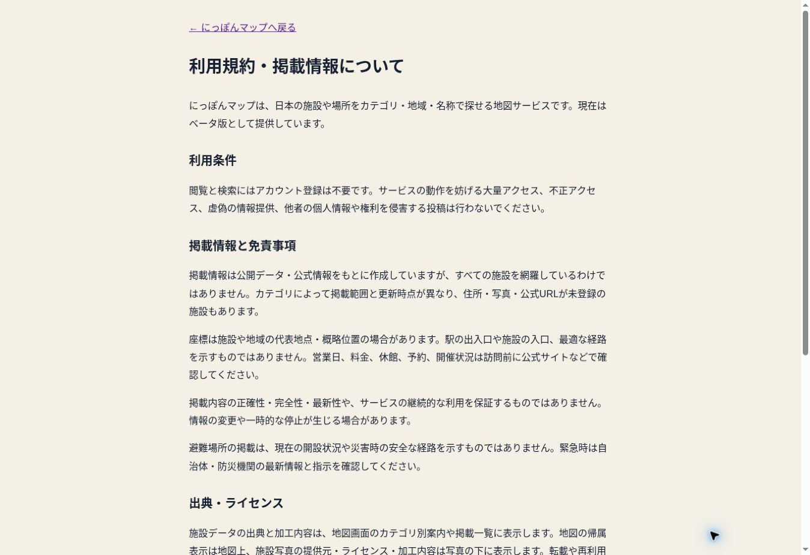

# にっぽんマップ 公開準備・引き継ぎ（2026-10-11）

今回の確認単位は下記20項目。完了数 / 全タスク数：**18 / 20**。一般公開の最終判定は保留。既存の公開URLでベータ版の提供を継続する。

公開URL： https://nippon-map.vercel.app/

## チェック一覧

| # | 作業 | 状態・証拠 |
|---|---|---|
| 1 | 最新mainと本番の確認 | 完了。開始時main `2ac83da8`、Vercel成功を確認 |
| 2 | React Hooks・型・選択処理のレビュー | 完了。条件分岐より前にHooksを配置、選択復元の競合を修正 |
| 3 | ビルド・型・Lint | 完了。Next.js本番ビルド内のLint/型検査、`check:types`成功 |
| 4 | 横断検索API | 完了。本番で東京駅2件、町田リス園1件、東京100件＋has_moreを確認 |
| 5 | カテゴリ横断検索・自動切り替え | 完了。動物園表示から東京駅を選択し鉄道駅9046件に切り替え |
| 6 | 同カテゴリ・都道府県解除時の選択維持 | 完了。東京都の動物園から町田リス園を選び、全国91件へ戻っても詳細を維持 |
| 7 | 選択施設への地図移動の目視確認 | **未完了**。コードはflyTo・ズーム13・ロード待ち解除を修正したが検証ブラウザはWebGL不可 |
| 8 | PCの詳細・外部リンク・フォーム | 完了。施設名・公式URL・Google Maps座標リンク・修正フォームを確認 |
| 9 | スマートフォン実機の地図・詳細操作 | **未完了**。レスポンシブCSSの既存チェックは成功、実機/モバイル画面の目視確認は未実施 |
| 10 | 読み込み・検索0件・上限・失敗処理 | 完了。古い検索結果を消去、キャンセル後の応答を無視、上限を表示。0件は本番、503はモックテストで確認 |
| 11 | 既存機能の疎通 | 完了。公開URLの既存35項目すべて成功。変更後は関連APIを追加検証 |
| 12 | SEOと地域案内 | 完了。本番127ガイドページ・128サイトマップURLの既存検査に成功 |
| 13 | RLS・公開DB権限 | 完了。全6テーブルRLS有効。不要なDML/TRUNCATE権限を取り消し |
| 14 | 情報提供の受付権限 | 完了。投稿はINSERTのみ、pending限定。anonで追加後ROLLBACKするDB検証に成功。テスト投稿は保存していない |
| 15 | 入力・外部リンク・構造化データの安全性 | 完了。検索式の制御、10秒タイムアウト、投稿12KB上限、異なるOrigin拒否、HTTP(S)リンク限定、JSON-LDの`<`エスケープ |
| 16 | 公開コード・管理機能の確認 | 完了。確認対象のアプリコードは公開用Supabaseキーのみ使用、公開管理画面はない。内部DBエラーを返さない |
| 17 | サービス説明・規約・免責・報告案内 | 完了。既存トップ説明を維持し`/terms`を追加。実在する情報提供フォームを案内 |
| 18 | プライバシー・利用計測停止 | 完了。実装と説明を照合、停止操作と再読み込み後のchecked状態を本番で確認 |
| 19 | データ・写真の出典表示 | 完了。既存写真のクレジットを維持。主要カテゴリの出典リンクを追加、airportsdataのMIT全文を配信。未登録のライセンスを推測で補っていない |
| 20 | GitHub反映・Vercel確認・引き継ぎ | 完了。下記コミットと本番確認結果を参照 |

## 実装コミット

- `a88146e4941f937d716ea3dde3e3f184d3221121`：横断検索の選択維持・結果上限・入力制御。
- `4f3aca80077726b2f74bb7f53300cb2aa283a91d`：利用規約・投稿API・DB権限縮小。
- `f0fa44b9621d962491da06fe3767fa9e7f891d98`：読み込んだカテゴリ/都道府県が一致するまで選択復元を待つ。
- `1f46a310b1f9577216c5802c4c37204bad02494e`：安全な外部リンク・JSON-LD・投稿ストリームのサイズ制限。
- `1993ce22d97501a33416f9b7843f371795c7dc9d`：主要カテゴリの出典と空港データのライセンス表示。

Vercelは上記5コミットすべて成功。最新アプリコミット `1993ce22` の本番デプロイ：
https://vercel.com/m011320011-6922/nippon-map/E6UcwpTxjVz7cQPrraiHJsDU5eKP

この記録を追加するコミットは文書・検証画像のみで、上記アプリコードを変更しない。

## 修正ファイル

- `components/MapApp.tsx`
- `app/api/search/route.ts`
- `app/api/submissions/route.ts`
- `app/api/places/route.ts`
- `app/page.tsx`、`app/terms/page.tsx`
- `app/guides/[category]/page.tsx`、`app/guides/[category]/[prefecture]/page.tsx`
- `lib/guide-categories.ts`
- `scripts/check-map-interactions.cjs`
- `tests/search.test.cjs`、`tests/submissions.test.cjs`、`tests/security-rendering.test.cjs`、`tests/source-credits.test.cjs`
- `supabase/migrations/20261011150000_public_client_least_privilege.sql`
- `public/licenses/airportsdata.txt`

## テストと制限

- `node --test tests/*.test.cjs`：6ファイル成功（検索、投稿、ガイド、利用計測、描画安全性、出典）。
- `npm run check:interactions`、`check:responsive`、`check:types`：成功。
- `npm run build`：成功（Lint・型検査を含む）。
- `npm run check:production`：35/35成功。
- `npm run check:seo`：127ガイドページ・128サイトマップURL成功。
- 最終アプリデプロイ後に空港97件・動物園91件・公衆トイレ255件と各出典、東京駅2件、MITライセンス配信を再確認。動物園の出典リンクは画面上でも表示を確認。
- 本番の不正投稿は400、異なるOriginは403、12KB超は413。保存される正常なテスト投稿を送信していない。
- 地図・マーカー・クラスタリング・ドラッグ・ズームはユーザーによる従前の確認がある。今回の新しいflyToはWebGL環境の制限により目視検証できていない。
- 安全性チェックは対象コード・DB設定のレビューとテストであり、侵入試験や完全な保証ではない。
- POSTのサイズ制限や検索の件数/時間上限は適用済み。分散レート制限は未実装で、公開後は受付件数を観察して追加する。

## DB状態

- 有効施設：11,059件、うち鉄道駅：9,046件（本番再集計）。住所補完は今回実施していない。
- 公開用anon/authenticated：categories/places/sourcesはSELECTのみ、place_submissionsはINSERTのみ。
- map_usage_eventsの列単位の投稿権限は変更していない。投稿・計測データの公開SELECTポリシーはない。
- Supabase Security Advisor：重大/WARNなし。`place_exclusions`はRLS有効・ポリシーなしのINFOが1件。非公開の拒否設定なので公開ポリシーを追加していない。
- Advisor案内： https://supabase.com/docs/guides/database/database-linter?lint=0008_rls_enabled_no_policy
- 施設データの追加・削除・住所の推測登録は実施していない。

## 発生した問題と対処

- 本番で同カテゴリの施設選択が消える競合を再現 → 読み込み済みscopeの照合を追加 → 本番で町田リス園の維持を再確認。
- Hooks依存配列変更で既存の文字列契約テストが失敗 → 新しいprefecture依存に更新 → 再テスト成功。
- 出典オブジェクトの重複キーでTypeScriptビルド失敗 → カテゴリ分岐ごとに設定 → 再ビルド成功。
- 出典集計SQLで存在しない`sources.url`を参照 → 実スキーマの`source_url`に修正 → 再集計成功。DB変更なし。
- Web検索でairportsdataのraw LICENSE取得に失敗 → 原本をHTTPSで取得して著作権表示を含む全文を保存。

## 次に実行すること

1. WebGL対応のPCで動物園から「東京駅」を検索・選択。鉄道駅へ切り替わり、東京へ移動・拡大してピンが見えることを確認。
2. スマホで同じ操作と、東京都に絞った動物園から「町田リス園」の選択、詳細を閉じる操作を確認。
3. 上の2項目が正常なら公開準備20/20とし、一般公開判定を更新する。異常があれば機能部分だけ修正・再テストする。
4. 公開後は検索順位、モバイルの施設位置、分散レート制限、誤り訂正、住所・公式URL補完を順に進める。住所全件登録を公開条件にしない。

